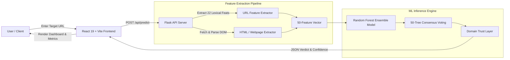

# 🛡️ CyberGuard — AI-Powered Phishing Detection System

[](https://www.python.org/)
[](https://reactjs.org/)
[](https://vitejs.dev/)
[](https://flask.palletsprojects.com/)
[](https://scikit-learn.org/)

An advanced, real-time Phishing Website Detection System powered by Machine Learning. CyberGuard analyzes target URLs across **50 distinct security dimensions** (22 lexical URL features + 28 live DOM/HTML behavioral features) to classify websites as **Legitimate** or **Phishing** using an ensemble Random Forest model.

---

## 🌟 Key Features

- **50-Feature Real-Time Analysis Pipeline**:
  - **22 URL Lexical Features**: URL length, character continuity, entropy ratios, obfuscation indicators (`%xx`, `@`), subdomain depths, IP-based hosting detection, TLD legitimacy metrics, and special character distributions.
  - **28 Live DOM / HTML Features**: Live web scraping via BeautifulSoup, popup detection (`alert()`, `window.open()`), external form actions, iframe injection, password/banking/crypto keyword triggers, favicon legitimacy, anchor link integrity (`#`, dead links, external domains), and redirect hopping.
- **High-Accuracy Random Forest Classifier**:
  - Trained on 50,000+ verified benign and malicious URL samples (`MLDataset.csv`).
  - Ensemble voting transparency: reveals exact vote breakdown across all decision trees in the ensemble.
- **Domain Trust Verification**:
  - Built-in whitelisting and structural heuristic checks for verified global domains.
- **Modern React + Vite Frontend**:
  - Cyberpunk security dark-mode interface with neon accents and glassmorphism.
  - Real-time 5-stage scanning progress indicator.
  - Dynamic verdict dashboard with confidence gauge, consensus breakdown, URL component breakdown, and searchable 50-feature inspection tables.
- **RESTful API Backend**:
  - High-performance Flask REST API with CORS and single-command launcher.

---

## 🏗️ Architecture Overview



---

## 📁 Repository Structure

```
PhishingDetection/
├── app.py                      # Flask REST API backend & static file server
├── run_app.py                  # One-click launcher (starts backend & opens browser)
├── main.py                     # Model training & evaluation pipeline
├── predict_url.py              # Inference pipeline & feature alignment
├── feature_extractor.py        # 22 Lexical URL feature extraction algorithms
├── html_feature_extractor.py   # 28 Live DOM & HTML feature extraction algorithms
├── domain_trust.py             # Domain trust & reputation verification
├── curate_and_split_dataset.py # Dataset preprocessing and train/test split
├── augment_dataset.py          # Data augmentation and feature balance utilities
├── test_system.py              # Backend integration test suite
├── test_complex_urls.py        # Edge-case URL testing
├── random_forest_model.pkl     # Pre-trained Random Forest model
├── MLDataset.csv               # Complete 50-feature dataset
├── X_train.csv / X_test.csv    # Training and testing feature splits
├── y_train.csv / y_test.csv    # Training and testing label splits
├── confusion_matrix.png        # Model evaluation performance chart
├── .gitignore                  # Git ignore rules for Python & Node
├── README.md                   # Project documentation
│
└── frontend/                   # Modern React Frontend (Vite)
    ├── index.html              # HTML entry template
    ├── vite.config.js          # Vite configuration & backend proxy
    ├── package.json            # Frontend dependencies & scripts
    └── src/
        ├── App.jsx             # Main application orchestrator
        ├── main.jsx            # React root mount
        ├── index.css           # CyberGuard design system & styling
        ├── constants/
        │   └── featureDescriptions.js  # Definitions for all 50 extracted features
        └── components/
            ├── Navbar.jsx              # Header & system status badges
            ├── ScannerForm.jsx         # Target URL input form
            ├── ScanningAnimation.jsx   # 5-stage live analysis animation
            ├── VerdictCard.jsx         # Verdict, confidence & probability bar
            ├── UrlComponents.jsx       # Parsed URL structure (domain, path, etc.)
            ├── NetworkMetadata.jsx     # Live HTTP status, title & redirect logs
            ├── FeatureInspection.jsx   # Tabbed inspection tables (22 URL / 28 HTML / 50 Vector)
            └── Footer.jsx              # Credits & system info
```

---

## 🚀 Quick Start & Installation

### Prerequisites
- **Python 3.10+**
- **Node.js 18+** & **npm**

---

### Step 1: Clone the Repository
```bash
git clone https://github.com/your-username/PhishingDetection.git
cd PhishingDetection
```

---

### Step 2: Install Python Dependencies
```bash
pip install flask requests beautifulsoup4 pandas scikit-learn joblib
```

---

### Step 3: Install Frontend Dependencies & Build
```bash
cd frontend
npm install
npm run build
cd ..
```

---

### Step 4: Run the Application

#### Option A: One-Click Launcher (Recommended)
```bash
python run_app.py
```
*Starts the Flask server at `http://127.0.0.1:5000` and automatically opens your default web browser.*

#### Option B: Standalone Development Mode
1. Start Flask API:
   ```bash
   python app.py
   ```
2. In a separate terminal, start the React dev server:
   ```bash
   cd frontend
   npm run dev
   ```
   *Visit `http://localhost:3000` (or the URL displayed in Vite).*

---

## 📡 API Reference

### 1. Health Check
- **Endpoint**: `GET /api/health`
- **Response**:
```json
{
  "status": "online",
  "model_loaded": true,
  "model_type": "RandomForestClassifier",
  "expected_features": 50
}
```

### 2. URL Classification
- **Endpoint**: `POST /api/predict`
- **Request Headers**: `Content-Type: application/json`
- **Request Body**:
```json
{
  "url": "https://www.example.com"
}
```
- **Response Sample**:
```json
{
  "success": true,
  "url": "https://www.example.com",
  "verdict": "Legitimate Website",
  "is_phishing": false,
  "confidence_score": 98.45,
  "confidence_type": "Ensemble Tree Consensus (Random Forest)",
  "tree_votes": {
    "legitimate": 49,
    "phishing": 1,
    "total_trees": 50
  },
  "probabilities": {
    "legitimate": 98.45,
    "phishing": 1.55
  },
  "components": {
    "Domain": "example.com",
    "Scheme": "https",
    "Path": "/",
    "Subdomain": "None",
    "Query": "None",
    "Fragment": "None"
  },
  "fetch_metadata": {
    "status_code": 200,
    "page_title": "Example Domain",
    "redirect_count": 0,
    "fetch_success": true
  },
  "features": {
    "url_features": { "URLLength": 23, "IsHTTPS": 1, "...": "..." },
    "html_features": { "HasTitle": 1, "HasPasswordField": 0, "...": "..." },
    "all_50_features": { "...": "..." }
  }
}
```

---

## 🧪 Model Training & Retraining

To retrain the Random Forest model on the curated dataset:
```bash
python main.py
```
This trains the model, computes validation accuracy, precision, recall, and F1-score, and generates `random_forest_model.pkl` along with `confusion_matrix.png`.

---

## 🔒 Security & Privacy Notice
*This system is intended for research, educational, and defense purposes to protect end-users from cyber threats and fraudulent web resources.*
